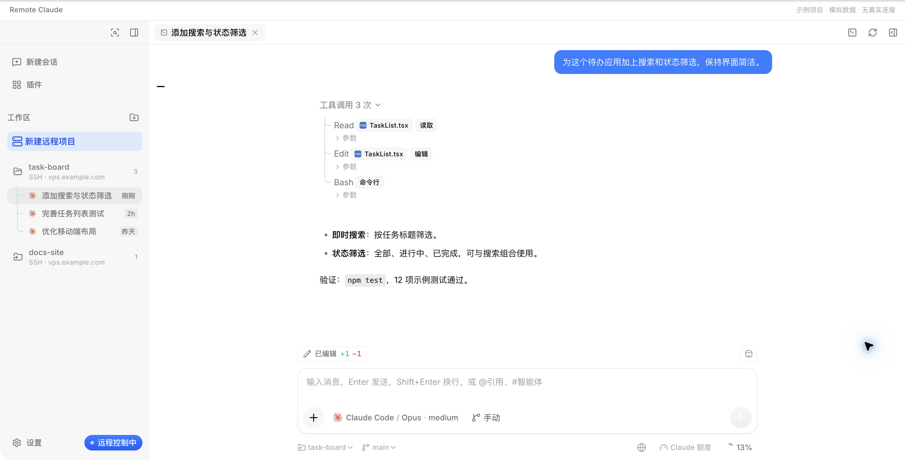
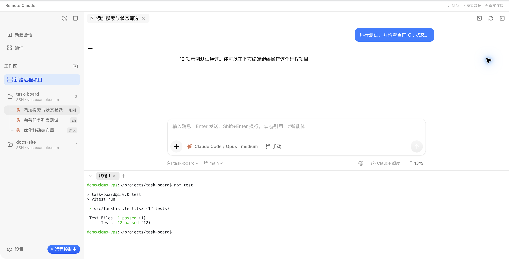
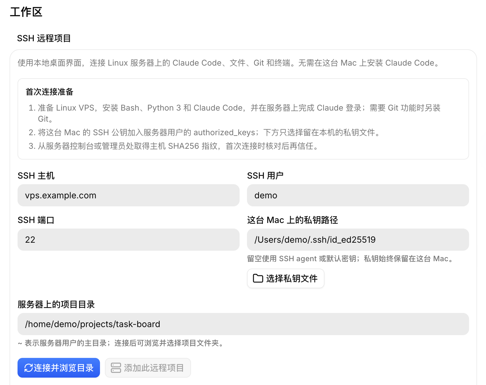

# Remote Claude

**Claude Code on your VPS. A desktop workspace on your Mac.**

**English** · [简体中文](README.zh-CN.md)

[VPS setup](#prepare-your-vps) · [Getting started](#getting-started) · [Development](#development) · [Contributing](CONTRIBUTING.md)

Remote Claude is a macOS desktop client for Claude Code running on a Linux VPS over SSH. Chat with Claude, manage remote projects, edit files, review Git changes, and open a terminal in one window.

It is for developers who want to keep their repositories, development tools, and Claude Code execution on their own server while working through a desktop interface. Install **Remote Claude on your Mac** and **Claude Code on your VPS**. Commands, builds, tests, and file changes run on the VPS using that server's environment.

Bring your own server and Claude account. Claude authentication stays on the VPS; the interface and history cache run on your Mac. The client connects directly over SSH. This is an independent third-party project, derived from [CC GUI](https://github.com/zhukunpenglinyutong/desktop-cc-gui).

> **Preview · macOS / Apple Silicon.** The current preview is distributed privately by the maintainer. Packages use ad-hoc signing and are not notarized by Apple. Compiled applications are not stored in this repository. See [current limitations](#current-limitations) before installing.

## Prepare your VPS

Before opening the app, prepare a Linux user with SSH access and permission to write to your project directories. Use **the same Linux user** to install and sign in to Claude Code and to connect from Remote Claude. Enable the VPS's SSH service and allow its port in your firewall or cloud security group. The VPS must also be able to reach Claude's services.

### 1. Install tools and sign in on the VPS

The following is an **Ubuntu/Debian example**, assuming you can already log in to the VPS. Run it in a VPS terminal as the user you will connect with. Use your distribution's package manager on other systems. Only the system-package step uses `sudo`.

```sh
sudo apt-get update
sudo apt-get install -y bash python3 git curl ca-certificates util-linux
```

Install Claude Code as that Linux user using the [official Linux installer](https://code.claude.com/docs/en/setup), then authenticate:

```sh
curl -fsSL https://claude.ai/install.sh | bash
export PATH="$HOME/.local/bin:$PATH"
claude --version
claude auth login
claude auth status
mkdir -p "$HOME/projects"
```

Ensure `~/.local/bin` is also on this user's **login-shell PATH**. The `export` above affects the current terminal only; for Bash, add that line to the login profile the user loads, such as `~/.profile` or `~/.bash_profile`. The fresh SSH check below verifies that the app can find Claude Code outside your interactive terminal.

On a server without a browser, open the login URL on your Mac and follow the terminal's instructions, including pasting a code back if prompted. See the [official authentication guide](https://code.claude.com/docs/en/authentication). Sign in with an account that has Claude Code access, then start `claude` in a project directory and confirm that a conversation works.

Put your repositories and their development dependencies on the VPS. You can use `~/projects` as a parent directory and add an existing project or create a new one from the app. The client uses the existing SSH service; you do not need to deploy a separate Remote Claude web service.

### 2. Enable SSH key access from your Mac

Add your Mac's **public** SSH key to the VPS user's `~/.ssh/authorized_keys`, or use your cloud provider's SSH key setup. Keep the private key on your Mac. The [first-connection guide](docs/remote-claude-trial.zh-CN.md) (Chinese) includes key creation and server-fingerprint checks.

In a **new Mac terminal**, verify key-based access and the remote login environment. Replace the placeholder user, host, and port with your own; add `-i /path/to/private-key` if using a non-default key:

```sh
ssh -p 22 -o PreferredAuthentications=publickey your-user@your-vps.example.com 'bash -lc "command -v claude && claude auth status"'
```

Verify the server's host fingerprint through a trusted channel before accepting it. If your key requires a passphrase, load it into your Mac's SSH agent with `ssh-add`. The check should print the Claude executable path and a signed-in authentication status. If it cannot find `claude`, fix the remote user's login-shell PATH first. Once this works, continue with [app installation and connection](#getting-started).

## A workspace for remote development

- **Chat and control tasks** — streamed responses, tool activity, permission requests, and task cancellation.
- **Organize projects** — add an existing VPS directory or create a project in a chosen parent directory.
- **Work with files and Git** — browse, edit, search, and perform common Git operations on the VPS.
- **Use an integrated terminal** — open a remote SSH shell at the bottom of the window.
- **Keep history available** — read the local cache first, refresh in the background, and view cached conversations offline.
- **Track usage** — see conversation context usage separately from account-wide five-hour and weekly limits, when available.
- **Set up SSH in the app** — select a local key, verify the server fingerprint, and check remote tools and Claude authentication.

## Screenshots

These screenshots use the application's actual UI components with demo projects, conversations, and terminal output.

**Remote projects and chat**



**Integrated SSH terminal**



**First connection**



## How it works

```text
Mac · Remote Claude
  Interface · connection settings · history cache
                     │
              SSH key authentication
                     │
Linux VPS
  Claude Code · project files · Git · shell
                     │
              Your Claude account
```

Your Mac does not need Claude Code installed. The VPS does not need an additional web service. Connections use SSH key authentication and retain OpenSSH host identity checks.

## Requirements

| Component | Requirement |
| --- | --- |
| Mac | macOS; Apple Silicon is the currently validated architecture |
| Server | A Linux VPS reachable over SSH, with a user that can access the project directory |
| Remote tools | Bash, Python 3, `setsid` (provided by `util-linux` on Ubuntu/Debian), and Claude Code; Git is optional for Git features |
| Claude account | Claude Code signed in as the remote user, with access to Claude Code and a CLI that supports structured authentication status |
| SSH authentication | A usable private key on the Mac, a default SSH key, or an SSH agent |
| Connectivity | Mac → VPS SSH port; VPS → Claude services |

For Claude Code installation and authentication, see the [official setup guide](https://code.claude.com/docs/en/setup).

## Getting started

### 1. Prepare your VPS

Complete the [VPS setup above](#prepare-your-vps): working SSH key access, remote tools, Claude Code authentication, and a writable project directory. Have the server's SHA256 host fingerprint ready from your cloud provider's console or an existing trusted server session.

### 2. Install the app

Obtain a preview package and its checksum manifest from the maintainer, or [build from source](#development). Open the DMG and drag `Remote Claude.app` into `Applications`.

Current preview packages are not notarized, so macOS may warn that the developer cannot be verified. Verify the package source and SHA256, then follow the operating system's security prompts. Packaging with your own Developer ID is supported by the build script; see [packaging](#packaging).

### 3. Connect a project

Open **Settings → Workspaces → SSH remote projects** and enter:

| Field | What to enter |
| --- | --- |
| SSH host | Your VPS IP address or DNS name |
| SSH user | The Linux user with Claude Code configured and access to the project |
| SSH port | `22`, unless your server uses another port |
| Private key | Select a key on your Mac, or leave blank to use default keys or an SSH agent |
| Project directory | `~` starts at the remote user's home directory; browse after connecting |

Connect and browse directories. For a new host, compare the displayed fingerprint with the trusted fingerprint you obtained earlier, then explicitly trust the matching key. The app checks remote tools and Claude authentication before you select and add a project directory.

A changed host key blocks the connection; the app does not silently replace an existing trust record.

### 4. Start working

Open the project from the sidebar and create a conversation. Chat, file operations, Git, and the integrated terminal operate on that VPS.

To start a new project, choose **New remote project** in the sidebar, select a parent directory on the VPS, and enter a project name. An existing directory with the same name will not be overwritten.

A more detailed [installation and first-connection guide](docs/remote-claude-trial.zh-CN.md) is available in Chinese.

## Data and credentials

| Data | Where it lives |
| --- | --- |
| App settings, workspace records, and history cache | `~/.ccgui-remote-vps` on your Mac |
| Project files and Claude Code sessions | Your VPS |
| SSH private key | Your Mac; the app stores its path and uses local SSH for authentication |
| Claude authentication and quota-query OAuth token | Your VPS; the token is not returned to the Mac |

Remote workspaces use the VPS's Claude configuration. Model-provider keys configured on the Mac are not forwarded to the server. The app uses the bundle identifier `local.ccgui.remote-vps` and a data directory separate from upstream CC GUI.

Only previously cached conversations are available offline. Fetching new messages and running tasks require a connection.

Conversation context usage and account limits are separate measurements. Account usage queries depend on an internal Claude endpoint that may change; unavailable values are shown as unknown rather than estimated.

## Development

Native builds require macOS, Xcode Command Line Tools, Node.js, pnpm, and Rust stable. The repository pins `pnpm@10.29.3`. Packaging also requires Python 3.

```sh
git clone git@github.com:TianwenWei/remote-claude.git
cd remote-claude
pnpm install --frozen-lockfile
./scripts/build-remote-macos.sh
```

Cloning requires repository access. If you received a source archive, extract it and start at the dependency installation step.

The default release app is written to:

```text
src-tauri/target/release/bundle/macos/Remote Claude.app
```

For development:

```sh
pnpm exec tauri dev --features remote-vps --config src-tauri/tauri.remote.conf.json
```

For a debug app bundle:

```sh
./scripts/build-remote-macos.sh --debug
```

Remote builds require **both** the `remote-vps` Cargo feature and `tauri.remote.conf.json` to preserve the app identity, data isolation, and update configuration. The Remote build script supplies both. Use these commands rather than the upstream default build entry points.

### Packaging

```sh
python3 scripts/package-remote-macos.py --ad-hoc
```

This produces an Apple Silicon preview package in `artifacts/remote-claude-trial/`: a DMG, an app ZIP, a build manifest, and SHA256 checksums. The manifest records the source revision, architecture, signing, and notarization status.

The script also offers Intel, Universal, Developer ID signing, and notarization options. These options do not establish that those configurations have been validated. See the [Remote development and build guide](README.remote-vps.md) (Chinese) for details.

### Validation

Local check examples:

```sh
pnpm build
pnpm exec vitest run src/features/settings/SshWorkspacesCard.test.tsx
cargo test --manifest-path src-tauri/Cargo.toml --features remote-vps --lib engine::ssh_onboarding::tests
node --test tests/xterm-production.test.mjs
```

Run `pnpm build` before the production xterm test. Live SSH and model tests require an explicitly authorized test host and scope; see [CONTRIBUTING.md](CONTRIBUTING.md).

Validation so far centers on the maintainer's Apple Silicon Mac and authorized VPS. Compatibility across other VPS setups, Intel Macs, and a formally signed distribution has not been established. Passing local checks alone does not validate a live SSH connection.

## Current limitations

- This Remote variant targets macOS and Linux SSH servers. Upstream engines and desktop platforms are not all supported in remote workspaces.
- Remote Worktree management, local computer-use tools, and local memory tools are unavailable. Worktrees can be managed in the remote terminal.
- Registering identical or nested project paths across different SSH hosts has limitations.
- The first-connection flow has limited support for advanced SSH configurations, including ProxyJump, ProxyCommand, HostName redirection, host certificates, and custom revocation policies.
- Older Claude Code versions that cannot report a verifiable authentication status are blocked during initial setup with an explanation.
- Upstream automatic updates are disabled. Update manually by replacing the app; settings and cached history are retained.

## Troubleshooting

| Symptom | First check |
| --- | --- |
| SSH timeout or closed connection | Network reachability, the VPS SSH service, and key authentication; cached history remains readable |
| Host key mismatch | Verify server identity and any reinstall through the server console before updating local OpenSSH trust records |
| Claude Code missing or not signed in | Check installation and authentication in the remote user's login environment |
| Git unavailable | Install Git on the VPS to enable Git features; chat remains available |
| Account usage unknown | Confirm that the remote authentication method supports the query; unavailable quota data is not estimated |

## Feedback and contributions

Reproducible bug reports, documentation improvements, and focused pull requests are welcome. Use the [bug report template](.github/ISSUE_TEMPLATE/bug_report.yml) and include the app version, Mac architecture and macOS version, reproduction steps, and redacted error text. Do not share private keys, tokens, or complete conversations.

See [CONTRIBUTING.md](CONTRIBUTING.md) for development checks, live-test boundaries, and documentation conventions. The [English](README.md) and [Chinese](README.zh-CN.md) READMEs are maintained together.

## Attribution and licensing materials

Remote Claude is based on [zhukunpenglinyutong/desktop-cc-gui](https://github.com/zhukunpenglinyutong/desktop-cc-gui) 1.1.4. Thanks to its authors and contributors.

The upstream snapshot lacks a root license file. Available licensing materials, historical references, and artwork provenance are recorded in [UPSTREAM-NOTICE.md](UPSTREAM-NOTICE.md); review that record before broader redistribution. The Claude name and artwork belong to their respective rights holders. Remote Claude is not an Anthropic product.
